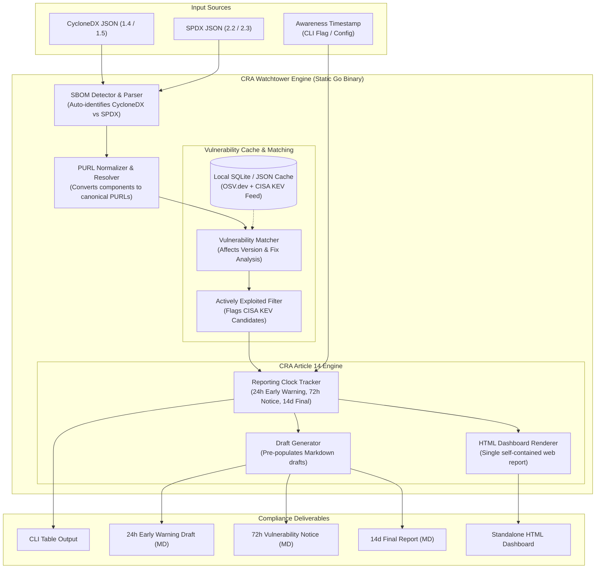

# Architecture: CRA Vulnerability Watchtower

`cra-watchtower` ingests product Software Bills of Materials (SBOMs), correlates components against public vulnerability feeds (OSV) and the CISA Known Exploited Vulnerabilities (KEV) catalog, monitors mandatory reporting deadlines, and produces audit-ready compliance drafts.

## Pipeline Architecture Diagram

## Architectural Components

1. **Format Ingestion & Detection:**
   The `internal/sbom` package scans the initial JSON structure without requiring pre-configuration. It identifies `bomFormat: "CycloneDX"` or `spdxVersion: "SPDX-..."` and deserializes into a unified component model.

2. **PURL Normalization (`internal/sbom/purl.go`):**
   Converts ad-hoc package declarations into strictly validated Package URLs (`pkg:<type>/<namespace>/<name>@<version>`). When PURLs are absent, canonical fallbacks are dynamically generated using ecosystem heuristics.

3. **Vulnerability Cache & Matching (`internal/vulndb` & `internal/matcher`):**
   Offline-first SQLite or cached JSON storage containing OSV vulnerability records and CISA KEV entries. Matches version constraints against component releases without requiring live network calls in production or test environments.

4. **Reporting Clock Tracker (`internal/clock`):**
   Maintains timezone-aware compliance clocks. Calculates exact deadlines:
   - **$T_{24}$:** Early warning to ENISA / CSIRT.
   - **$T_{72}$:** Full vulnerability notification.
   - **$T_{14d}$:** Final remediation summary.

5. **Draft & Dashboard Renderers (`internal/drafts` & `internal/report`):**
   Embeds Go HTML templates via `go:embed` to produce clean, single-page offline reports and pre-filled Markdown draft notifications with clear markers for required human inputs.
